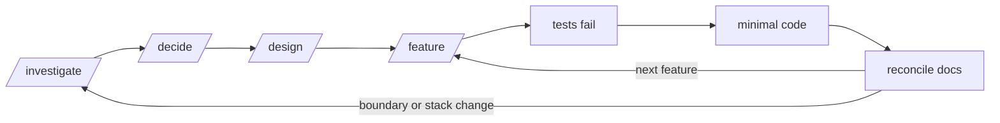

# Strata

An engineering baseline for projects built with AI agents. Fork it, then investigate, decide, design, test, and only then build.

> After forking, replace this section with the project's name and one-line purpose. Leave the rest.

## Workflow

## Map

| Path | What lives there | Changes |
|---|---|---|
| `AGENTS.md` | Rules the agent reads every turn (Codex directly, Claude Code through `CLAUDE.md`, which only imports it) | Rarely |
| `docs/engineering/` | How we build: architecture, stack selection, testing, security, diagrams | Rarely, shared by every fork |
| `docs/product/` | Why and for whom: vision, use cases | Per project |
| `docs/research/` | Evidence behind choices | Per decision |
| `docs/decisions/` | ADRs: what we chose and why | Append-only |
| `docs/architecture/` | Context, modules, data + RLS, threats, deployment | With the design |
| `docs/features/` | Spec and test list per feature | Per feature |
| `docs/templates/` | Starting points for the above | Rarely |
| `.claude/skills/` | Procedures: `/investigate`, `/decide`, `/design`, `/feature` | Rarely |
| `.claude/agents/reviewer.md` | Rule-checking reviewer | Rarely |
| `.agents/skills`, `.codex/agents/` | Codex view of the same skills (symlink) and reviewer (generated from `.claude/agents/`) | Never by hand |
| `src/` | Created by `/design` once the stack ADR is accepted | Always |

## Starting a project

1. Fork, then fill in `docs/product/vision.md`.
2. Describe what you want in plain words. The agent runs the matching skill by itself: research and ADRs for the stack and other costly choices, then the design, then one feature at a time.
3. Type a `/command` only to force a specific step.
