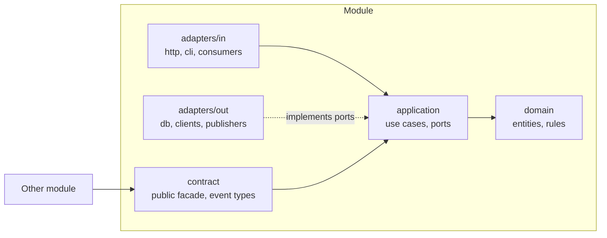
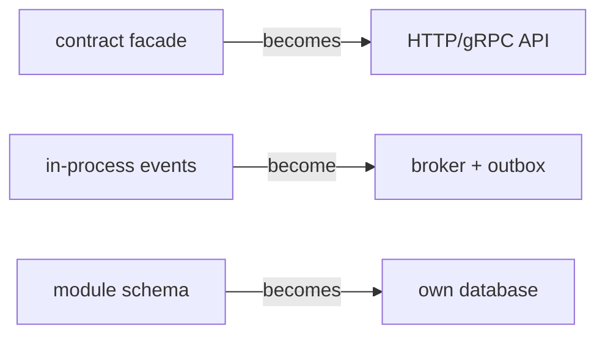

# Architecture

Modular monolith: one deployable, many modules, each one a bounded context that could become a service with a move, not a rewrite.

## Layers



| Layer | Contains | May depend on |
|---|---|---|
| `domain` | Entities, value objects, invariants, domain events | Nothing but `shared/kernel` |
| `application` | Use cases, port interfaces, transactions | `domain` |
| `adapters/in` | HTTP/CLI/queue handlers: parse, call a use case, map the result | `application` |
| `adapters/out` | Port implementations: repositories, API clients, publishers | `application`, `domain` |
| `contract` | The only thing other modules may import: facade + event schemas | `application` |

## Folder shape

Adapt names to the language idiom chosen in the stack ADR (packages, crates, namespaces). Keep the shape.

```
src/
  app/                  composition root: config, wiring, startup. No logic.
  modules/
    <context>/
      README.md         contract, owned data, events, diagrams
      contract/
      domain/
      application/
      adapters/in/
      adapters/out/
  shared/kernel/        tiny, stable primitives: ids, money, clock, result
```

Test placement follows the language convention (colocated or `tests/` mirror), fixed in the stack ADR.

## Rules

**Boundaries**
- A module never imports another module's internals. It imports only `contract/`.
- `shared/kernel` admits code only if it is generic, stable, and used by at least two modules. Business rules never go there.
- An architecture test fails the build on any boundary violation: ArchUnit (JVM), ArchUnitNET (.NET), dependency-cruiser (JS/TS), import-linter (Python), go-arch-lint or depguard (Go), separate workspace crates (Rust).

**Data**
- Each module owns one schema (or table prefix if the store has no schemas). No other module reads or writes it.
- No foreign keys across modules. Reference by ID and keep consistency through events.
- IDs are UUIDv7: sortable, and safe to generate anywhere.
- Timestamps are stored in UTC. Time comes from an injected clock.

**Communication**
- Synchronous: call another module's `contract` facade, in-process.
- Asynchronous: publish domain events named in the past tense (`InvoiceIssued`), with a versioned schema. Handlers are idempotent.
- When a real broker is introduced, publish through a transactional outbox.

**Statelessness**
- No request-spanning state in process memory: sessions, caches, and locks live in external stores.
- Config follows twelve-factor: environment only, validated at startup, fail fast.

## Extraction path

Extract a module only when there is evidence: independent scaling, team ownership, deploy cadence, or fault isolation. Record it in an ADR.


