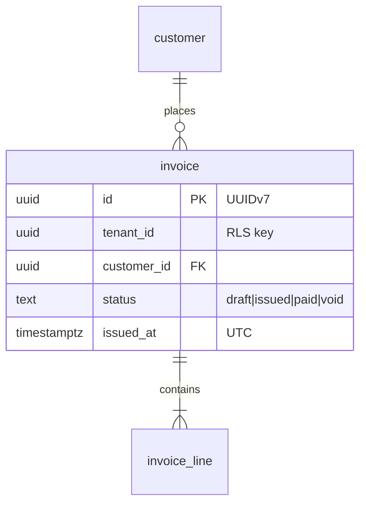
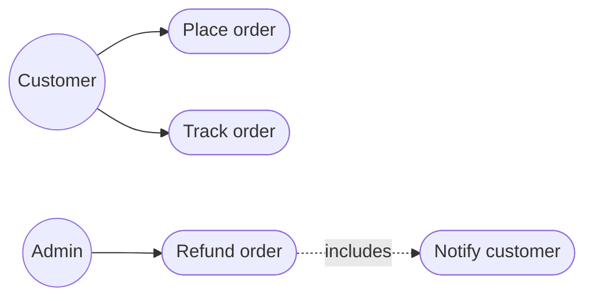

# Diagrams

All diagrams are Mermaid, stored inline in the Markdown that explains them, and must render on GitHub.

## Which diagram, where

| Question | Mermaid type | Location |
|---|---|---|
| What is the system and who uses it? (C4 L1/L2) | `flowchart` | `architecture/context.md` |
| Which modules exist and how do they relate? | `flowchart` (context map) | `architecture/modules.md` |
| What can each actor do? | `flowchart` with actor nodes* | `product/use-cases.md` |
| What data exists and how does it relate? | `erDiagram` + RLS table | `architecture/data.md`, module README |
| Who calls whom, in what order? | `sequenceDiagram` | `features/*.md`, `architecture/flows/` |
| What states can an entity be in? | `stateDiagram-v2` | module README |
| Where does it run? | `flowchart` | `architecture/deployment.md` |
| How does an algorithm or workflow branch? | `flowchart` | next to the explaining text |

\* Mermaid has no UML use-case diagram. Use `flowchart LR` with actors as `((Actor))` and use cases as `([Use case])`.

## Conventions

- One diagram answers one question. Past roughly 15 nodes, split it.
- Node and entity names match code identifiers exactly.
- Each diagram sits under a heading that states its question.
- A diagram that no longer matches the code is a bug.

## Data model convention

Mermaid cannot express policies, so RLS goes in a table right below the ER diagram:

| Table | Policy | Command | Role | USING | WITH CHECK |
|---|---|---|---|---|---|
| invoice | tenant_isolation | ALL | app_user | `tenant_id = current_setting('app.tenant_id')::uuid` | same |

Mark PII and secret columns in the ER comment: `"PII"`, `"secret"`.

## Use case convention

